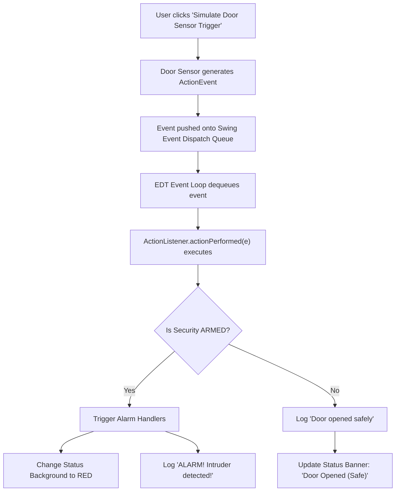

# Event-Driven System Design

## System Name: Smart Home Controller

---

## Part 1: Event Sources
List all components that can generate events:
1. **Light Switch Toggle Button** (`JToggleButton`) — Generates user toggle state change events (`ActionEvent`) when clicked to turn lights on or off.
2. **Security System Toggle** (`JToggleButton`) — Generates armed/disarmed state change events (`ActionEvent`) when toggled by the homeowner.
3. **Door & Window Magnetic Sensor** (`JButton` / Hardware Sensor) — Generates breach/door-open simulation events (`ActionEvent`) when entry is detected.
4. **Motion Detector / PIR Sensor** — Generates motion pulse events when movement is detected in armed zones.
5. **System Heartbeat / Timer** (`javax.swing.Timer`) — Generates periodic tick events every second to refresh timestamps and evaluate timeout policies.

---

## Part 2: Events
List all possible events in the system:

| Event Name | Source | Description |
| :--- | :--- | :--- |
| `LIGHTS_TOGGLED` | Light Switch Toggle Button | User toggled the living room light switch between ON and OFF. |
| `SECURITY_STATE_CHANGED` | Security Mode Toggle Button | User transitioned the alarm between ARMED and DISARMED states. |
| `DOOR_OPENED` | Door Contact Sensor | A physical entrance door or window was opened. |
| `MOTION_DETECTED` | PIR Motion Sensor | Infrared motion was picked up in a monitored zone. |
| `ALARM_TRIGGERED` | Alarm Controller Logic | Dispatched internally when a breach occurs while security is armed. |
| `TIMER_TICK` | System Clock Timer | Periodic interval event fired every 1000ms for housekeeping. |

---

## Part 3: Event Handlers
For each event, describe what should happen:

| Event | Handler Action |
| :--- | :--- |
| `LIGHTS_TOGGLED` | Reads toggle selection; updates light state text ("Lights: ON" / "Lights: OFF"); appends timestamped entry to the Event Log; updates top status banner. |
| `SECURITY_STATE_CHANGED` | Toggles armed mode; if armed, turns status background amber and logs "Security system ARMED"; if disarmed, restores background and logs "Security system DISARMED". |
| `DOOR_OPENED` | Checks current security status: If security is DISARMED, logs normal entry and shows safe status. If security is ARMED, dispatches `ALARM_TRIGGERED`. |
| `MOTION_DETECTED` | Checks security status: If armed, logs intrusion and triggers strobe/siren; if disarmed, turns on convenience path lights. |
| `ALARM_TRIGGERED` | Flashes main window background RED (`Color(255, 120, 120)`); sets status label to "ALARM ACTIVE! Intruder Detected!"; logs high-priority emergency alert in event log. |
| `TIMER_TICK` | Updates the live time display in the system status bar without blocking the UI thread. |

---

## Part 4: Event Flow Diagram
Trace how events flow through the system:

### Visual Sequence Flow

```
[User / Hardware Sensor]
          │
          â–¼
   [Event Source] ────────> Creates ActionEvent / SensorEvent Object
                                          │
                                          â–¼
                                   [Event Queue]  (Java EDT Queue)
                                          │
                                          â–¼
                                   [Event Loop]   (EventQueue.dispatchEvent)
                                          │
                                          â–¼
                             [Registered ActionListener]
                                          │
                         ┌────────────────┴────────────────┐
                         â–¼                                 â–¼
              [Update System State]             [Mutate Swing GUI]
              - Log to JTextArea                - Change label text
              - Toggle flags                    - Flash background red
```

### State & Decision Flowchart



---

## Part 5: Potential Issues & Mitigation Strategies

1. **Issue 1: Blocking the EDT with Heavy Operations (e.g. Remote Cloud Notification)**
   - *Risk:* If sending an SMS or calling an IoT webhook runs synchronously inside the `actionPerformed` handler, the UI will freeze and become completely unresponsive.
   - *Mitigation:* Offload network calls and heavy I/O to background threads (`SwingWorker` or `new Thread().start()`), and update GUI controls exclusively via `SwingUtilities.invokeLater()`.

2. **Issue 2: Concurrency & Race Conditions Across Multiple Threads**
   - *Risk:* Multiple background threads updating UI components directly can lead to race conditions, corrupted rendering, or random `NullPointerException`s.
   - *Mitigation:* Adhere strictly to the Swing single-thread rule: all component state reads/writes must happen on the Event Dispatch Thread.

3. **Issue 3: Memory Leaks from Dangling Event Listeners**
   - *Risk:* Dynamically registering sensor listeners or logging listeners without unregistering them when components or sub-panels are discarded keeps references alive, preventing garbage collection.
   - *Mitigation:* Ensure symmetrical lifecycle management: explicitly deregister listeners (`removeActionListener`) or clear collections when elements are removed.

4. **Issue 4: Sensor Event Flooding / Debouncing**
   - *Risk:* Hardware door sensors or motion detectors can bounce, generating hundreds of events per second and overwhelming the event queue.
   - *Mitigation:* Implement debouncing or rate-limiting filters at the event source layer so only state transitions after a settling threshold (e.g., 250ms) are dispatched to the queue.
