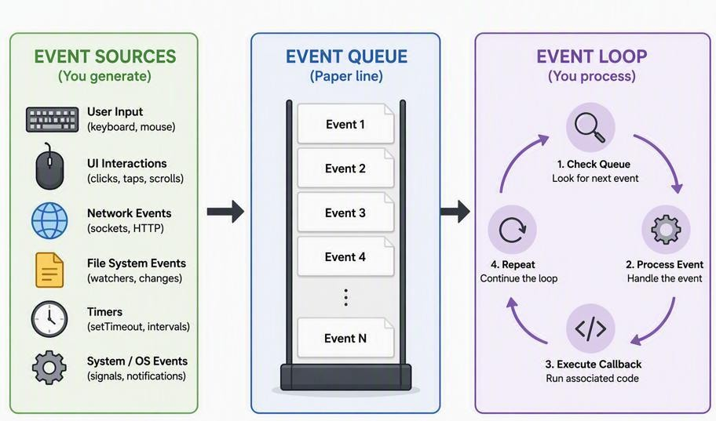

# Week 1: Self-Paced Practical Activities for Event-Driven Programming

## How to Use This Guide

Work through each activity in order. Each activity builds on the previous one. You should complete all activities without instructor assistance. The activities are designed to be hands-on and practical.

- **Estimated Total Time:** 2–3 hours (can be split across multiple sessions)
- **Primary Language & Framework:** Java (Standard JDK, Swing)
- **Target Repository:** `event-driven-programming-java`

---

## What You Will Achieve By The End

By completing this guide, you will be able to:

1. **Define** the fundamental components of an event-driven system (**Event**, **Source**, **Listener**, **Handler**).
2. **Compare and contrast** procedural, functional, and event-driven programming paradigms.
3. **Explain** the role of the event loop and event queue in an event-driven system.
4. **Identify** real-world event-driven systems and their key components.

### Progress Checklist

- [ ] Outcome 1: Define EDP fundamental components
- [ ] Outcome 2: Compare and contrast paradigms
- [ ] Outcome 3: Explain the event loop and event queue
- [ ] Outcome 4: Identify real-world EDP systems

---

## Activity 1: "Spot the Components" — Real-World EDP Scavenger Hunt

- **Duration:** 40 minutes
- **Learning Outcomes Addressed:** #1, #4
- **Purpose:** Learn to identify event sources, events, listeners, and handlers in everyday systems.

### Instructions

#### Step 1: Watch These Videos (15 minutes)
Watch each video and pay attention to the interactions:
- **ATM Machine Operation** (Search YouTube: *"ATM machine transaction process"*)
- **Microwave Oven Use** (Search YouTube: *"how to use microwave oven"*)
- **Traffic Light System** (Search YouTube: *"traffic light operation animation"*)
- **Video Game Gameplay** (Search YouTube: *"simple video game gameplay no commentary"*)
- **Elevator Operation** (Search YouTube: *"how elevator works animation"*)

#### Step 2: Complete This Table (15 minutes)
For each system you watched, fill in the table below in your notes or deliverables file:

| System | Event Source | Event | Listener | Handler / Action |
| :--- | :--- | :--- | :--- | :--- |
| ATM Machine Operation | | | | |
| Microwave Oven Use | | | | |
| Traffic Light System | | | | |
| Video Game Gameplay | | | | |
| Elevator Operation | | | | |

##### Example Completed Row:
| System | Event Source | Event | Listener | Handler / Action |
| :--- | :--- | :--- | :--- | :--- |
| ATM Machine Operation | Keypad button | Button pressed | ATM software | Verify PIN |
| ATM Machine Operation | Card slot | Card inserted | Card reader | Read card data |
| ATM Machine Operation | Cash dispenser | Cash taken | Sensor | End transaction |

#### Step 3: Find Three More Systems (10 minutes)
Think of three more event-driven systems in your daily life. Add them to your table.

Ideas:
- Smartphone touchscreen
- Netflix / YouTube interface
- Online shopping website
- Car dashboard
- Smart TV remote
- Security alarm system
- Self-checkout at supermarket

#### Step 4: Self-Check
Answer these questions in your notes:
1. What is the difference between an event source and an event listener?
2. Can one event source have multiple listeners? Give an example.
3. Can one listener handle events from multiple sources? Give an example.

> [!IMPORTANT]
> **Deliverable:**
> A completed table with at least 8 systems analyzed, showing Event Source, Event, Listener, and Handler for each.

---

## Activity 2: "Build the Event Loop" — Physical Simulation

- **Duration:** 30 minutes
- **Learning Outcomes Addressed:** #3
- **Purpose:** Understand how the event loop and event queue work by physically simulating them.

### Instructions

#### Step 1: Gather Materials (5 minutes)
Collect these items:
- 20 small pieces of paper (or sticky notes)
- Pen or pencil
- A flat surface (table or floor)

#### Step 2: Set Up Your Simulation Space (5 minutes)
Arrange your space into three distinct zones from left to right:

```
┌───────────────────────────┐      ┌───────────────────────────┐      ┌───────────────────────────┐
│       EVENT SOURCES       │      │        EVENT QUEUE        │      │        EVENT LOOP         │
│                           │ ───> │                           │ ───> │                           │
│  (Stack of pending cards) │      │   (FIFO buffer of cards)  │      │     (Processor / Worker)  │
└───────────────────────────┘      └───────────────────────────┘      └───────────────────────────┘
```



#### Step 3: Create Event Cards (5 minutes)
Write these events on your paper pieces (one per paper):
- **Card 1:** "Button A Clicked"
- **Card 2:** "Button B Clicked"
- **Card 3:** "Text Field Updated: 'Hello'"
- **Card 4:** "Timer Fired"
- **Card 5:** "Window Resized"
- **Card 6:** "Checkbox Selected"
- **Card 7:** "Menu Item Clicked"
- **Card 8:** "Key Pressed: 'A'"
- **Card 9:** "Mouse Moved"
- **Card 10:** "Button A Clicked"

#### Step 4: Simulate the Event Loop (15 minutes)
Follow these steps **EXACTLY** in order:

##### Round 1: Simple Processing
1. Place all 10 cards face-down in a stack on the left (**Event Sources** area).
2. Move the top card to the right (**Event Queue** area).
3. Read the card aloud.
4. Say what handler would process it, then move it to the right again (**Event Loop** area).
5. Repeat until all cards are processed.

*Example:*
- **Action:** Pick up Card 1
- **Say:** "Card 1: Button A Clicked"
- **Say:** "Handler: Button A's ActionListener"
- **Say:** "Action: Display message 'Button A clicked'"
- **Move:** Card to Event Loop area
- Repeat for Cards 2 through 10.

##### Round 2: Multiple Events at Once
1. Place 5 cards face-up in a row (**Event Queue**).
2. Process them one by one from **LEFT to RIGHT** (First-In, First-Out order).
3. Say aloud: "Processing first event in queue..."

##### Round 3: Simulating a Blocked Event Loop
1. Place 5 cards in the queue.
2. Pick up the first card.
3. Say: *"This handler takes 30 seconds to complete."*
4. Slowly count to 10 while holding the card.
5. **Notice:** The other cards are **WAITING** and cannot be serviced.
6. After counting, process the card and move to the next.

##### Answer These Questions:
1. What happened to the other events while you were "stuck" on the slow handler?
2. What would a user see if this happened in a real application?
3. How could this problem be fixed?

#### Step 5: Write Your Reflection (5 minutes)
Write a paragraph (5–7 sentences) explaining:
- What the event queue does.
- What the event loop does.
- Why the event loop should never be blocked.

> [!IMPORTANT]
> **Deliverable:**
> A written reflection paragraph explaining the event loop, event queue, and why blocking causes application unresponsiveness.

---

## Activity 3: "Procedural vs. Event-Driven" — Side-by-Side Coding

- **Duration:** 90 minutes
- **Learning Outcomes Addressed:** #2
- **Purpose:** Experience the difference between procedural and event-driven programming by writing both implementations.

### Instructions

#### Step 1: Create Your Project Folder (5 minutes)
Create a folder structure on your computer:
```text
Week1_EDP/
├── procedural/
│   └── ProceduralCalculator.java
└── eventdriven/
    └── EventDrivenCalculator.java
```

#### Step 2: Write the Procedural Calculator (25 minutes)
Create a file called `ProceduralCalculator.java`. Implement the calculator code:

```java
import java.util.Scanner;

public class ProceduralCalculator {
    public static void main(String[] args) {
        Scanner scanner = new Scanner(System.in);

        System.out.println("=== Procedural Calculator ===");
        System.out.println();

        // Step 1: Get first number
        System.out.print("Enter first number: ");
        double num1 = scanner.nextDouble();

        // Step 2: Get operator
        System.out.print("Enter operator (+, -, *, /): ");
        String operator = scanner.next();

        // Step 3: Get second number
        System.out.print("Enter second number: ");
        double num2 = scanner.nextDouble();

        // Step 4: Calculate
        double result = 0;
        switch (operator) {
            case "+":
                result = num1 + num2;
                break;
            case "-":
                result = num1 - num2;
                break;
            case "*":
                result = num1 * num2;
                break;
            case "/":
                if (num2 != 0) {
                    result = num1 / num2;
                } else {
                    System.out.println("Error: Cannot divide by zero");
                    scanner.close();
                    return;
                }
                break;
            default:
                System.out.println("Invalid operator");
                scanner.close();
                return;
        }

        // Step 5: Display result
        System.out.println();
        System.out.println("Result: " + num1 + " " + operator + " " + num2 + " = " + result);

        scanner.close();
    }
}
```

##### Reflection Questions for Procedural Calculator:
1. What is the exact order of steps in this program?
2. What happens if the user enters the wrong input at step 2?
3. Can the user calculate again without restarting the program?
4. Who controls the flow of this program — the user or the program?

#### Step 3: Write the Event-Driven Calculator (40 minutes)
Create a file called `EventDrivenCalculator.java`. Implement the GUI calculator using Swing:

```java
import javax.swing.*;
import java.awt.*;

public class EventDrivenCalculator extends JFrame {
    private JTextField display;
    private double firstOperand = 0;
    private String operator = "";
    private boolean startNewNumber = true;

    public EventDrivenCalculator() {
        // Window setup
        setTitle("Event-Driven Calculator");
        setDefaultCloseOperation(JFrame.EXIT_ON_CLOSE);
        setLayout(new BorderLayout(10, 10));

        // Display field
        display = new JTextField("0");
        display.setHorizontalAlignment(JTextField.RIGHT);
        display.setEditable(false);
        display.setFont(new Font("Arial", Font.BOLD, 28));
        display.setBackground(Color.WHITE);
        add(display, BorderLayout.NORTH);

        // Button panel
        JPanel buttonPanel = new JPanel(new GridLayout(4, 4, 5, 5));
        buttonPanel.setBorder(BorderFactory.createEmptyBorder(10, 10, 10, 10));

        // Row 1: 7, 8, 9, /
        buttonPanel.add(createNumberButton("7"));
        buttonPanel.add(createNumberButton("8"));
        buttonPanel.add(createNumberButton("9"));
        buttonPanel.add(createOperatorButton("/"));

        // Row 2: 4, 5, 6, *
        buttonPanel.add(createNumberButton("4"));
        buttonPanel.add(createNumberButton("5"));
        buttonPanel.add(createNumberButton("6"));
        buttonPanel.add(createOperatorButton("*"));

        // Row 3: 1, 2, 3, -
        buttonPanel.add(createNumberButton("1"));
        buttonPanel.add(createNumberButton("2"));
        buttonPanel.add(createNumberButton("3"));
        buttonPanel.add(createOperatorButton("-"));

        // Row 4: 0, C, =, +
        buttonPanel.add(createNumberButton("0"));
        buttonPanel.add(createClearButton("C"));
        buttonPanel.add(createEqualsButton("="));
        buttonPanel.add(createOperatorButton("+"));

        add(buttonPanel, BorderLayout.CENTER);

        // Window settings
        setSize(350, 450);
        setLocationRelativeTo(null);
    }

    private JButton createNumberButton(String text) {
        JButton btn = new JButton(text);
        btn.setFont(new Font("Arial", Font.BOLD, 20));

        // THIS IS THE EVENT HANDLER
        btn.addActionListener(e -> {
            if (startNewNumber) {
                display.setText(text);
                startNewNumber = false;
            } else {
                display.setText(display.getText() + text);
            }
        });

        return btn;
    }

    private JButton createOperatorButton(String op) {
        JButton btn = new JButton(op);
        btn.setFont(new Font("Arial", Font.BOLD, 20));

        // THIS IS THE EVENT HANDLER
        btn.addActionListener(e -> {
            firstOperand = Double.parseDouble(display.getText());
            operator = op;
            startNewNumber = true;
        });

        return btn;
    }

    private JButton createEqualsButton(String text) {
        JButton btn = new JButton(text);
        btn.setFont(new Font("Arial", Font.BOLD, 20));
        btn.setBackground(new Color(100, 200, 100));

        // THIS IS THE EVENT HANDLER
        btn.addActionListener(e -> {
            double secondOperand = Double.parseDouble(display.getText());
            double result = 0;

            switch (operator) {
                case "+":
                    result = firstOperand + secondOperand;
                    break;
                case "-":
                    result = firstOperand - secondOperand;
                    break;
                case "*":
                    result = firstOperand * secondOperand;
                    break;
                case "/":
                    if (secondOperand != 0) {
                        result = firstOperand / secondOperand;
                    } else {
                        display.setText("Error");
                        startNewNumber = true;
                        return;
                    }
                    break;
                default:
                    return;
            }
            display.setText(String.valueOf(result));
            startNewNumber = true;
        });

        return btn;
    }

    private JButton createClearButton(String text) {
        JButton btn = new JButton(text);
        btn.setFont(new Font("Arial", Font.BOLD, 20));
        btn.setBackground(new Color(255, 150, 150));

        // THIS IS THE EVENT HANDLER
        btn.addActionListener(e -> {
            display.setText("0");
            firstOperand = 0;
            operator = "";
            startNewNumber = true;
        });

        return btn;
    }

    public static void main(String[] args) {
        // ALWAYS start Swing applications on the EDT
        SwingUtilities.invokeLater(() -> {
            new EventDrivenCalculator().setVisible(true);
        });
    }
}
```

##### Reflection Questions for Event-Driven Calculator:
1. Can the user click buttons in any order?
2. What happens if the user makes a mistake?
3. Can the user calculate again without restarting?
4. Who controls the flow — the user or the program?
5. How many event handlers are in this program?

#### Step 4: Complete the Comparison Table (15 minutes)
Fill in this table in your notes:

| Aspect | Procedural | Event-Driven |
| :--- | :--- | :--- |
| **Who controls the flow?** | Program (step-by-step sequential control) | User (via asynchronous events and actions) |
| **Can user make mistakes and recover easily?** | Hard (program often terminates or gets stuck) | Easy (press Clear 'C' or enter new numbers) |
| **Can user interact in any order?** | No, strict fixed sequence | Yes, user interacts at any time in any order |
| **How many possible execution paths?** | Very few, predetermined branching | Infinite, dependent on user input sequences |
| **Code organization** | Top-down linear functions / main method | Decoupled components, listeners, and handlers |
| **User experience** | Rigid, terminal-based prompt loop | Interactive, responsive, visual interface |

#### Step 5: Write Your Reflection (5 minutes)
Write a paragraph (5–7 sentences) explaining:
- The main differences between the two approaches.
- Which approach you prefer for interactive applications.
- Why event-driven programming is better for graphical interfaces.

> [!IMPORTANT]
> **Deliverable:**
> - Two working calculator programs (`ProceduralCalculator.java`, `EventDrivenCalculator.java`).
> - Completed comparison table.
> - Written reflection paragraph.

---

## Activity 4: "Debug the Event Handler" — Code Repair Challenge

- **Duration:** 45 minutes
- **Learning Outcomes Addressed:** #1, #3
- **Purpose:** Learn to identify and fix common event-driven programming mistakes.

### Instructions

#### Step 1: Create Bug Fix Project (5 minutes)
Create a folder called `BugFixChallenge` with four Java files:
- `Bug1_BlockingEDT.java`
- `Bug2_MissingListener.java`
- `Bug3_WrongThread.java`
- `Bug4_MemoryLeak.java`

#### Step 2: Fix Bug 1 — Blocking the EDT (10 minutes)
**Original buggy code:**
```java
processButton.addActionListener(e -> {
    // BUG: This blocks the EDT!
    try {
        Thread.sleep(5000);
    } catch (InterruptedException ex) {
        ex.printStackTrace();
    }
    statusLabel.setText("Done!");
});
```
- **Symptom:** UI completely freezes for 5 seconds; cannot move, resize, or repaint window.
- **Cause:** Long-running task executed directly on the Event Dispatch Thread (EDT).
- **Fix:** Offload operation to a background thread (`new Thread(...).start()`) and dispatch UI updates back to the EDT via `SwingUtilities.invokeLater()`.

#### Step 3: Fix Bug 2 — Missing Listener (10 minutes)
**Original buggy code:**
```java
// BUG: No ActionListener added to the button!
// The button does nothing when clicked.
add(countLabel);
add(incrementButton);
```
- **Symptom:** Clicking "Increment" produces no effect.
- **Cause:** Event source exists, but no `ActionListener` is registered with it.
- **Fix:** Register `incrementButton.addActionListener(e -> { count++; countLabel.setText("Count: " + count); });`.

#### Step 4: Fix Bug 3 — Wrong Thread (10 minutes)
**Original buggy code:**
```java
new Thread(() -> {
    while (running) {
        // BUG: Updating GUI from background thread!
        timeLabel.setText("Time: " + new Date());
        try {
            Thread.sleep(1000);
        } catch (InterruptedException ex) {
            ex.printStackTrace();
        }
    }
}).start();
```
- **Symptom:** UI thread race conditions, visual glitches, or intermittent rendering exceptions.
- **Cause:** Swing components are not thread-safe and must only be modified on the EDT.
- **Fix:** Wrap `timeLabel.setText(...)` inside `SwingUtilities.invokeLater(() -> timeLabel.setText("Time: " + new Date()));`.

#### Step 5: Fix Bug 4 — Memory Leak (10 minutes)
**Original buggy code:**
```java
JButton removeButton = new JButton("Remove All");
removeButton.addActionListener(e -> {
    // BUG: Buttons are removed from UI but not from the list!
    buttonPanel.removeAll();
    buttonPanel.revalidate();
    buttonPanel.repaint();
    // createdButtons list still holds references!
});
```
- **Symptom:** Memory consumption grows continuously with repeated button creations and removals.
- **Cause:** UI references are cleared, but references remain in the `createdButtons` collection, preventing garbage collection.
- **Fix:** Add `createdButtons.clear();` when removing buttons.

#### Step 6: Document Your Fixes (5 minutes)
Create a file called `BugFixes.md` and document each fix following standard markdown structure:

| Markdown Syntax | Meaning |
| :--- | :--- |
| `# Heading` | Creates a title or major header |
| `**text**` | Makes text bold |
| `- item` | Creates an unordered bullet item |
| ```` ```java ```` | Fenced code block with language highlight |

> [!IMPORTANT]
> **Deliverable:**
> - Four fixed Java files.
> - `BugFixes.md` documentation file detailing symptoms, causes, fixes, and code changes.

---

## Activity 5: "Design Your Own Event-Driven System"

- **Duration:** 60 minutes
- **Learning Outcomes Addressed:** #1, #2, #3, #4
- **Purpose:** Apply all Week 1 concepts by designing and prototyping a complete event-driven system.

### Instructions

#### Step 1: Choose Your System (5 minutes)
Select **ONE** of these systems to design:
- [x] **Smart Home Controller** — Controls lights, thermostat, security, and door sensors
- [ ] **Restaurant Order System** — Manages orders, kitchen dispatch, and payment events
- [ ] **Library Management System** — Handles checkouts, returns, reservations, and fines
- [ ] **Fitness Tracker** — Monitors steps, heart rate triggers, calorie goals, and alarms
- [ ] **Parking Garage** — Manages entry barrier, exit ticket, space count, and payments

#### Step 2: Complete the Design Worksheet (20 minutes)
Create a file called `SystemDesign.md` and complete the five core design parts:
1. **Part 1: Event Sources** — Identify components that generate events.
2. **Part 2: Events Catalog** — Tabulate event names, origins, and trigger conditions.
3. **Part 3: Event Handlers** — Describe state mutations and side effects for each event.
4. **Part 4: Event Flow Diagram** — Flowchart tracing events from user interaction to UI refresh.
5. **Part 5: Potential Issues & Mitigation** — Concurrency, blocking tasks, and error handling.

#### Step 3: Build a Simple Prototype (30 minutes)
Create a Java Swing application that demonstrates your selected system.

**Requirements:**
- At least 3 buttons or interactive components.
- At least 3 distinct event handlers.
- Clear display of system state (status banner and timestamped event log).
- Proper use of the EDT (`SwingUtilities.invokeLater()`).

##### Prototype Implementation Template:
```java
import javax.swing.*;
import java.awt.*;
import java.util.Date;

public class SmartHomePrototype extends JFrame {
    private JLabel statusLabel;
    private JTextArea eventLog;
    private JToggleButton lightsToggle;
    private JToggleButton securityToggle;
    private JButton doorButton;

    public SmartHomePrototype() {
        setTitle("Smart Home Controller");
        setDefaultCloseOperation(JFrame.EXIT_ON_CLOSE);
        setLayout(new BorderLayout(10, 10));

        // Status Panel (NORTH)
        statusLabel = new JLabel("System Ready", SwingConstants.CENTER);
        statusLabel.setFont(new Font("Arial", Font.BOLD, 16));
        statusLabel.setOpaque(true);
        statusLabel.setBackground(new Color(230, 240, 250));
        statusLabel.setBorder(BorderFactory.createEmptyBorder(10, 10, 10, 10));
        add(statusLabel, BorderLayout.NORTH);

        // Event Log (CENTER)
        eventLog = new JTextArea(12, 35);
        eventLog.setEditable(false);
        eventLog.setFont(new Font("Monospaced", Font.PLAIN, 12));
        add(new JScrollPane(eventLog), BorderLayout.CENTER);

        // Control Panel (SOUTH)
        JPanel controlPanel = new JPanel(new GridLayout(3, 1, 6, 6));
        controlPanel.setBorder(BorderFactory.createEmptyBorder(10, 10, 10, 10));

        // Lights Toggle
        lightsToggle = new JToggleButton("Lights: OFF");
        lightsToggle.addActionListener(e -> {
            if (lightsToggle.isSelected()) {
                lightsToggle.setText("Lights: ON");
                logEvent("Lights turned ON");
                statusLabel.setText("Living Room Lights: ON");
            } else {
                lightsToggle.setText("Lights: OFF");
                logEvent("Lights turned OFF");
                statusLabel.setText("Living Room Lights: OFF");
            }
        });

        // Security Toggle
        securityToggle = new JToggleButton("Security: DISARMED");
        securityToggle.addActionListener(e -> {
            if (securityToggle.isSelected()) {
                securityToggle.setText("Security: ARMED");
                logEvent("Security system ARMED");
                statusLabel.setText("Security System: ARMED");
                statusLabel.setBackground(new Color(255, 230, 200));
            } else {
                securityToggle.setText("Security: DISARMED");
                logEvent("Security system DISARMED");
                statusLabel.setText("Security System: DISARMED");
                statusLabel.setBackground(new Color(230, 240, 250));
            }
        });

        // Door Sensor Button
        doorButton = new JButton("Simulate Door Sensor Trigger");
        doorButton.addActionListener(e -> {
            logEvent("Door sensor triggered");
            if (securityToggle.isSelected()) {
                logEvent("ALARM! Unauthorized intrusion detected!");
                statusLabel.setText("ALARM ACTIVE! Intruder Detected!");
                statusLabel.setBackground(new Color(255, 100, 100));
            } else {
                logEvent("Door opened safely (Security is disarmed)");
                statusLabel.setText("Door Opened (Safe)");
            }
        });

        controlPanel.add(lightsToggle);
        controlPanel.add(securityToggle);
        controlPanel.add(doorButton);
        add(controlPanel, BorderLayout.SOUTH);

        setSize(480, 450);
        setLocationRelativeTo(null);
    }

    private void logEvent(String event) {
        String timestamp = new Date().toString();
        eventLog.append("[" + timestamp + "] " + event + "\n");
        eventLog.setCaretPosition(eventLog.getDocument().getLength());
    }

    public static void main(String[] args) {
        SwingUtilities.invokeLater(() -> {
            new SmartHomePrototype().setVisible(true);
        });
    }
}
```

> [!IMPORTANT]
> **Deliverable:**
> - Completed `SystemDesign.md` design specification.
> - Working Java prototype implementation (`SmartHomePrototype.java`).

---

## Activity 6: Final Self-Assessment

- **Duration:** 20 minutes
- **Learning Outcomes Addressed:** All (#1, #2, #3, #4)
- **Purpose:** Verify that you have achieved all four learning outcomes.

### Instructions

#### Step 1: Complete This Self-Assessment
Answer each question thoroughly in your notes or deliverables summary:

##### Learning Outcome 1: Define EDP Components
1. What is an event? Give two examples.
2. What is an event source? Give two examples.
3. What is an event listener? Give two examples.
4. What is an event handler? Give two examples.
5. Draw a diagram showing how these four components relate to each other.

##### Learning Outcome 2: Compare Paradigms
1. How does procedural programming differ from event-driven programming?
2. What is the main advantage of event-driven programming for GUIs?
3. In which scenario would you choose procedural programming over event-driven?

##### Learning Outcome 3: Event Loop and Queue
1. What is the event loop? What does it do?
2. What is the event queue? How does it work?
3. Why should the event loop never be blocked?
4. What is the EDT in Java Swing?

##### Learning Outcome 4: Real-World Examples
1. List five real-world event-driven systems.
2. For one system, identify all four EDP components.
3. Why are most modern applications event-driven?

#### Step 2: Score Yourself

| Score | Meaning |
| :--- | :--- |
| **13–15 correct** | **Excellent!** You have mastered Week 1 concepts. |
| **10–12 correct** | **Good!** Review the topics you missed. |
| **7–9 correct** | **Satisfactory.** Re-do activities related to missed topics. |
| **Below 7** | **Need improvement.** Review all activities and notes. |

#### Step 3: Create Your Summary
Write a summary of everything you learned in Week 1, including key definitions, diagrams, and helpful code examples.

> [!IMPORTANT]
> **Deliverable:**
> - Completed self-assessment document (`SelfAssessment.md`).
> - One-page summary document.

---

## Summary of All Deliverables

| Activity | Deliverable | Learning Outcomes |
| :---: | :--- | :---: |
| **1** | Completed EDP Components Table | #1, #4 |
| **2** | Event Loop Reflection Paragraph | #3 |
| **3** | Two Calculator Programs + Comparison Table | #2 |
| **4** | Four Fixed Java Files + `BugFixes.md` | #1, #3 |
| **5** | `SystemDesign.md` + Working Java Prototype | #1, #2, #3, #4 |
| **6** | Self-Assessment + Summary Document | All |

---

## Troubleshooting Guide

| Problem | Root Cause | Solution |
| :--- | :--- | :--- |
| **JavaFX / Swing not available** | JDK missing or runtime mismatch | Ensure standard JDK is installed; Swing is bundled with Java SE. |
| **Program won't compile** | Syntax error or naming mismatch | Check for typos; ensure public class name matches file name exactly. |
| **GUI freezes** | Blocking operation on EDT | Offload heavy task to background `Thread` / `SwingWorker`. |
| **Button click does nothing** | Listener not attached | Verify `btn.addActionListener(...)` is called. |
| **Random GUI crashes / glitches** | Thread safety violation | Ensure all Swing updates run via `SwingUtilities.invokeLater()`. |

### Resources for Help
- **Oracle Java Tutorials:** [Swing Documentation](https://docs.oracle.com/javase/tutorial/uiswing/)
- **Stack Overflow:** [Java Swing Questions](https://stackoverflow.com/questions/tagged/swing)
- **Official Java API Documentation:** [Java SE Docs](https://docs.oracle.com/en/java/)
- **Markdown Reference:** [Markdown Cheat Sheet](https://www.markdownguide.org/cheat-sheet/)

---

## Pushing to GitHub — Complete Instructions

### Why GitHub?

| Benefit | Description |
| :--- | :--- |
| **Portfolio** | Shows employers your skills, clean code, and growth over time. |
| **Backup** | Your work is secure in the cloud even if your computer fails. |
| **Version Control** | Track changes, compare commits, and safely revert if needed. |
| **Collaboration** | Share code and reviews easily with classmates and instructors. |
| **Documentation** | Your markdown files become visible proof of learning and understanding. |
| **Professional Habit** | Software developers use Git/GitHub daily in professional environments. |

### Step-by-Step GitHub Setup

#### Step 1: Configure Your Repository on GitHub

| Field | What to Enter |
| :--- | :--- |
| **Repository name** | `event-driven-programming-java` |
| **Description** | My journey learning Event-Driven Programming in Java — Week 1 Activities |
| **Visibility** | Public |
| **Initialize repository** | Check "Add a README file" |
| **Add .gitignore** | Select "Java" template |
| **License** | MIT License (optional) |

#### Step 2: Clone and Push Changes
Open terminal / PowerShell and run:

```bash
# Clone existing repository
git clone https://github.com/YOUR-USERNAME/event-driven-programming-java.git
cd event-driven-programming-java

# Stage all files
git add .

# Commit with a descriptive message
git commit -m "Complete Week 1: Event-Driven Programming activities and documentation"

# Push to origin
git push origin main
```
